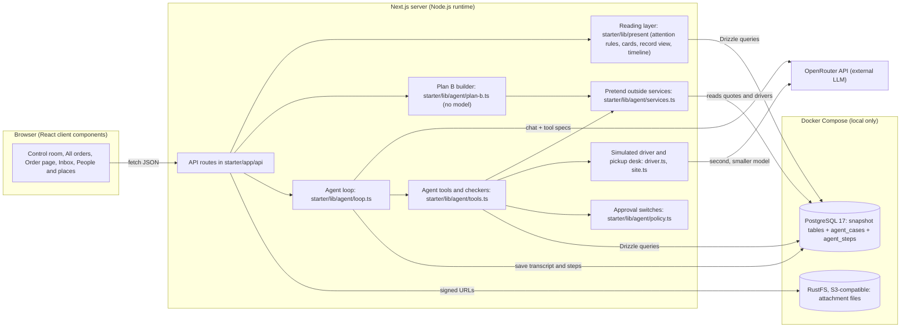

# Bahn Continuity — Technical Guide

A study guide for the two of us who will explain and change this code in front of judges. Everything here was checked against the code on `main` (up to PR #11), not guessed from file names. Where a claim depends on something we could not run, it says so.

A few words we use throughout:

- **Snapshot.** The dataset is a frozen picture of the business at `2026-10-21T09:00:00Z` (from `dataset/data/manifest.json`). Nothing in it changes by itself.
- **Order.** One car to move from a pickup to a delivery address. There are 100.
- **Case.** One run of our agent on one order. Stored in our own table `agent_cases`.
- **Step.** One thing that happened inside a case (a lookup, a message, a decision). Stored in `agent_steps`. The steps together are the trace.
- **Deterministic.** Plain code that always gives the same answer for the same input. No model involved.
- **LLM.** The language model we call through OpenRouter.

---

## 1. What this project is

Bahn Continuity is a control room for car delivery operations, built on Bahn's Next.js, TypeScript and Postgres starter. It reads Bahn's fictional snapshot of 100 orders and decides, with plain code, which orders need a person right now and which are fine. Orders that need a person sit in the middle of the home page ("Needs attention"), and everything else sits on the right ("On track"), each with a line saying what was checked. Next to the desk there is one real agent for the "on the road" area: breakdowns, sold-out or missed ferries, delays and pickups where the car is not where it should be. The agent is a language model working in a loop with tools. It first investigates (reads the records, asks the driver or the pickup site, sorts facts into confirmed, reported, planned and unknown) and then plans a recovery (options with arrival, cost and certainty, deadlines and a Plan B). It never changes anything that matters by itself; it hands a person exactly one decision. The driver and the pickup desk are played by a second, smaller model with a private script, so the agent has to ask rather than read the answer.

**The user journey, step by step**

1. **An issue exists in the data.** For example an open incident, a high-severity alert, an overdue work item, or another agent's proposal waiting for review. These are records in the snapshot.
2. **It reaches "Needs attention".** On every page load, `GET /api/overview` builds one card per order (`buildBoardCard` in `starter/lib/present/board.ts`). Each card gets attention items from `deriveAttention` (`starter/lib/present/attention.ts`) and a strongest "tone". The home page then splits cards with `splitQueue` (`starter/lib/present/queue.ts`): a card goes to Needs attention if its tone is danger, warn or accent, or if its agent case is waiting for a person or stopped. A case the agent closed takes the order off the desk.
3. **The operator sees it.** The queue row shows the car and route, "Critical" or "Not critical", time left, and who has the next move. Clicking it opens the workspace (`OrderFocus` in `starter/app/components/order-focus.tsx`): a header with one issue sentence, the next deadline as a countdown, the Speed / Cost / Certainty switch, one recommended action with Approve plan / Edit plan / Reject, and folded sections (evidence, Plan B, milestones, timeline, site pattern, agent trace, full record).
4. **A decision is made.** If the agent has a case on the order, the buttons post to `POST /api/cases/:id/decision` with `approve`, `change` or `reject`. If there is no case yet, the operator sees Plan B options prepared by code and can press "Hand to the agent", which opens a case (`POST /api/cases`).
5. **What is recorded afterwards.** The decision becomes a `person/decision` step. On approval of an agent-run action, a `system/action` step "Done (simulated): …" is added. The agent is told exactly what was approved and continues: it usually messages the driver, then closes the case or hands over the next decision. Everything is in `agent_steps`, visible as "Agent activity" on the case.

**A real example from our recorded runs: the BMW M4 that was not at the pickup (order `ord-00593`, reference CD-420593, Helsinki to Turku).**
The case opens with "Driver at Velantora Helsinki: reception cannot find the BMW M4 for this order." The agent reads the order, 7 messages, the alerts and incidents, the pickup details, and notices a site pattern at Velantora Helsinki. It messages the driver (still at reception, train in 45 minutes), then calls the pickup desk, which says the car is at the Vantaa satellite yard and the keys are in a key safe that opens only after the seller sends a release email naming Vantaa. It records findings, looks up backup drivers near Vantaa, checks the delivery promise (inside, with 121 hours to spare), tells the driver they will hear back within 30 minutes, and hands over. The checker sends the hand-over back once because the headline was 142 characters, and the findings back once because they cited a tool name as a source. The final decision is "Call the customer: ask them to send the release email naming Vantaa", with a drafted customer email, two alternatives, a Plan B (backup driver tomorrow morning) and three deadlines. All of this is in `starter/demo/recorded-cases.json`, 33 steps.

---

## 2. Architecture at a glance



**In plain English.** The browser only ever talks to our own API routes; it never sees the database or OpenRouter. The API routes do three kinds of work. Most requests go through the reading layer (`lib/present`), which loads records from Postgres with Drizzle and turns them into ready-to-show "views" using fixed rules. Plan B requests go to `plan-b.ts`, which runs the same lookup functions the agent uses, but without any model, so it is free and instant. Case requests go to the agent loop, which sends the conversation and the list of tools to OpenRouter, gets back "call these tools", runs them, and repeats until the agent hands over or closes the case. Some tools read the database, some calculate, some return made-up quotes (`services.ts`), and two of them "contact" people who are played by a second model (`driver.ts`, `site.ts`). Docker runs Postgres and a small S3-compatible file store for the PDFs and photos. OpenRouter is the only external service.

---

## 3. Full tech stack

Versions are from `starter/package-lock.json` (what `npm ci` installs).

| Technology / package | Version | Where it is used | Why / what it does here |
|---|---|---|---|
| Next.js (App Router) | 16.4.2 | `starter/app/**` pages and `starter/app/api/**` routes | One project for the pages and the server API. Routes use `export const runtime = "nodejs"`. Background agent work uses `after()` from `next/server` so the HTTP reply returns at once. Came with Bahn's starter. |
| React | 19.2.7 | Every page and component in `starter/app` | UI. Almost every page is a client component (`"use client"`) that fetches JSON from the API. |
| TypeScript | 7.0.2 | Whole codebase, `starter/tsconfig.json` (`strict: true`) | Types for records, views and tool outputs. `npm run typecheck` runs `tsc --noEmit`. |
| PostgreSQL | 17 (alpine image) | `starter/compose.yaml`, service `db`, port 5438 | Holds the snapshot and our agent tables. |
| Drizzle ORM | 0.45.4 | `starter/lib/schema.ts`, `lib/db.ts`, `lib/agent/conn.ts` | Typed queries. The schema file is the single source of truth for tables. |
| drizzle-kit | 0.31.11 | `starter/drizzle.config.ts`, `npm run db:push` | Creates or updates tables from `lib/schema.ts`. No migration files are kept. |
| postgres (postgres.js) | 3.4.9 | `lib/db.ts`, `lib/agent/conn.ts`, `scripts/seed.ts` | The Postgres driver under Drizzle. Pools of 5 connections. |
| Docker Compose | (whatever Docker ships) | `starter/compose.yaml` | Starts Postgres and RustFS locally with health checks, so `docker compose up -d --wait` waits until both are ready. |
| RustFS | 1.0.1 image | `compose.yaml` service `attachments`, ports 9009 and 9010 | S3-compatible store for the 58 fictional PDFs and photos. From the starter. |
| AWS SDK S3 client + presigner | 3.1155.0 | `lib/object-store.ts`, `app/api/orders/[id]/attachments/route.ts`, `scripts/seed-attachments.ts` | Uploads attachments and creates 15-minute signed read links. |
| OpenRouter | HTTP API, no SDK | `starter/lib/agent/model.ts` (`openRouterComplete`) | One key, any model. We call `https://openrouter.ai/api/v1/chat/completions` with plain `fetch`, OpenAI-style tool calling, and retry on 429 and 5xx. Default models: `anthropic/claude-sonnet-4.5` for the agent, `anthropic/claude-haiku-4.5` for the simulated driver and site. |
| Zod | **not used** | nowhere | There is no Zod in `package.json`. Tool arguments are described to the model as JSON Schema, and checked on our side by hand-written checks inside each tool's `run` function in `lib/agent/tools.ts`. See section 11. |
| dotenv | 18.0.8 | `lib/agent/conn.ts`, scripts, `drizzle.config.ts` | Loads `starter/.env` for scripts and the agent connection. |
| tsx | 4.23.15 | All `npm run` scripts in `starter/scripts` | Runs TypeScript scripts directly. |
| @fontsource/opendyslexic | 5.3.0 | Imported in `app/layout.tsx`; used by `:root[data-reading="easy"]` rules in `app/globals.css` | Easy reading mode font, bundled so it works offline. |
| Google Fonts (Manrope, Poppins, Reddit Mono) | n/a | `<link>` in `app/layout.tsx` | Interface and heading fonts. Falls back to system fonts without network. |
| CSS | plain CSS, one file | `starter/app/globals.css` (about 1,500 lines) | No Tailwind, no CSS-in-JS. The last section defines palette tokens (`--pal-*`) and role tokens (`--ui-*`); older token names point at them. |
| Icons | hand-written SVG | `starter/app/components/icons.tsx` (`Icon`) | Small path set, no icon library. |
| Charts | hand-written SVG | `starter/app/components/donut-chart.tsx` (`DonutChart`) | The All orders donut. No chart library. |
| Timelines | our own components | `order-timeline.tsx` (horizontal journey), `investigation.tsx` (reality timeline), case-view `Timeline` (agent trace) | No timeline library. |
| Tests | Node's `node:assert` + tsx | `scripts/unit-test.ts`, `scripts/agent-test.ts`, `scripts/smoke.ts`, `scripts/smoke-attachments.ts` | No Jest or Vitest. Each script prints "ok" lines or throws. |
| Python 3 (optional) | any | `check_packet.py` at the repo root | Bahn's own data completeness check. We did not change or rely on it. |

### What runs where?

- **Browser / client.** All React pages and components. It holds UI state only: the selected order, the Speed / Cost / Certainty choice (saved in `localStorage` under `desk-priority-v2`), Easy reading (`localStorage` key `reading-mode`), the picked donut lanes (`sessionStorage` key `board-lanes`), and polling timers. It never holds secrets and never calls OpenRouter.
- **Next.js server.** API routes, the reading layer (`lib/present`), the attention rules, Plan B, the agent loop and its tools, the pretend services, and the in-memory "is this case running" set. The OpenRouter key is read here only.
- **Database / containers.** Postgres holds the snapshot (13 tables plus one generic `related_records` table) and our two agent tables. RustFS holds attachment files.
- **External AI API.** OpenRouter, called only from `lib/agent/model.ts`, and only when a case runs (live agent, demo runner, or "Hand to the agent"). Plan B, the desk, the record pages and the seeded demo cases need no model at all.

---

## 4. Repository map

### Root level

| Path | What it owns | Who uses it | Careful with |
|---|---|---|---|
| `README.md` | Our project overview, run steps, then Bahn's original README below a line. | Judges, us. | It promises "no model key needed". Keep that true. |
| `PARTICIPANT-BRIEF.md` | Bahn's brief and judging criteria. | Us, coding agents. | Bahn's text, do not edit. |
| `OPERATIONS-CONTEXT.md` | How delivery work goes at Bahn, in plain words. | Background reading. | Bahn's text. |
| `dataset/` | The 100-order fictional snapshot as JSONL (`dataset/data/*.jsonl`), `manifest.json` with row counts and snapshot time, `README.md`, `SCHEMA.md`. | `scripts/seed.ts`, `scripts/smoke.ts`, `scripts/seed-attachments.ts`. | The seed refuses to run if a file's row count differs from `manifest.json`. |
| `attachments/` | 58 fictional files and `manifest.json` with hashes. | `lib/attachments.ts`, `scripts/seed-attachments.ts`, attachments API. | Hash checks fail if a file changes. |
| `mockups/` | Screenshots of Bahn's original starter. | Nothing in code. | Not our UI. |
| `check_packet.py` | Bahn's data completeness checker. | Nobody in our flow. | Optional. |
| `docs/BUILD-LOG.md` | How we built it with AI, step by step. | Judges (30% "how you worked with AI"). | Keep it honest; it is quoted in the video. |
| `docs/DEMO-SCRIPT.md` | The video walkthrough with timings. | Demo. | Must match the app. |
| `docs/PROJECT_TECHNICAL_GUIDE.md` | This file. | Us. | Explanation only. |

**Missing:** the brief we were given mentioned `docs/investigation/**`. That folder does not exist in this repo, and as far as git history shows it never did. `docs/BUILD-LOG.md` (step 7) records the same assumption. We worked from the brief and the code instead.

### `starter/` top level

| Path | What it owns | Careful with |
|---|---|---|
| `package.json` | Scripts and dependencies. `db:seed` runs **two** scripts: `seed.ts` then `demo-cases.ts`. | Changing script names breaks README steps and the demo script. |
| `compose.yaml` | Postgres on `127.0.0.1:5438`, RustFS on `127.0.0.1:9009` (API) and `9010` (console). | If you change a port, change `DATABASE_URL` or `S3_ENDPOINT` in `.env` too. |
| `.env.example` | Variable names with safe local defaults; `OPENROUTER_API_KEY` is empty. | Never put a real key here; it is committed. |
| `drizzle.config.ts` | Points drizzle-kit at `lib/schema.ts`. | |
| `next.config.ts` | Only turns off the dev indicator. | |
| `tsconfig.json` | `strict`, path alias `@/*` → `starter/*`. | The alias is used everywhere. |
| `AGENTS.md` | A note from Next.js for coding agents (this Next version differs from older docs). | Rewritten by `next dev`. |
| `ASSET-SOURCES.md` | Where the car images and make logos come from. | Licensing note. |
| `demo/recorded-cases.json` | Four real recorded agent runs (cases plus every step), about 380 KB. Saved 2026-10-25 08:30 UTC. | Loaded by `npm run db:seed`. If you change the case or step shape in `schema.ts`, this file may stop loading. |
| `public/brand`, `public/car-images`, `public/car-logos` | Bahn logo SVGs, generated model illustrations, make marks. | |

### `starter/lib/schema.ts` (database tables)

Owns every table definition (section 6). Called by Drizzle everywhere and by `drizzle-kit push`. **If changed carelessly:** the seed (`scripts/seed.ts`) truncates a fixed list of table names and maps JSONL fields to columns by hand, so a renamed column breaks seeding; the recorded cases in `demo/recorded-cases.json` are inserted as whole rows, so changing `agent_cases` or `agent_steps` columns breaks `demo:load`.

### `starter/lib/` other files

| File | Owns | Called by | Careful with |
|---|---|---|---|
| `lib/db.ts` | Drizzle connection for the web app (`import "server-only"`). Throws at import if `DATABASE_URL` is missing. | All `lib/present` loaders and some API routes. | `server-only` means importing it from a client component fails the build. Good. |
| `lib/attachments.ts` | Reading `attachments/manifest.json`, file paths, object keys, sha256. | Attachments API and seed. | |
| `lib/object-store.ts` | Builds the S3 client from `S3_*` variables. | Attachments API and seed. | |

### `starter/lib/present/` (the reading layer, all deterministic)

| File | Owns | Called by | Careful with |
|---|---|---|---|
| `load.ts` | `loadShared`, `loadOrder(id)`, `loadBoardBundles()`, `orderRefs`. All database reads for views. | API routes, `plan-b.ts`, `entity.ts`. | `loadOrder` is used by both the record page and Plan B; a change shows up in both. |
| `bundle.ts` | The `Bundle` type (everything about one order) and small helpers (`rows`, `str`, `journeyPlan`, `originPickupPoint`, `finalDeliveryPoint`). | Everything in `lib/present`. | Field names are used across many files. |
| `attention.ts` | `deriveAttention` (what needs a person and how serious), `deriveKeyDates` (pickup slot, promise, ETA and the "decisive" date), `chosenWindows`, `latestTracking`, `milestones`. | `board.ts`, `record.ts`. | **This is the attention rule.** Changing a tone here moves orders on and off the desk. |
| `queue.ts` | `needsPerson`, `needsAttention`, `splitQueue`, `followUp`, `watchStatus`, `latestCases`, severity labels. | Home page, All orders, overview API, unit tests. | The one rule for "Needs attention". Unit tests pin it. |
| `board.ts` | `buildBoardCard`: one card per order, plus `deriveChecks` ("no open alerts · driver on the road …"). | Overview API, entity pages. | |
| `record.ts` | `buildRecordView`: the full order page view (header, tiles, journey, threads, evidence, proposals, history). 840 lines. | Order API, Plan B. | Plan B reads `view.header.keyDates`, `view.journey`, `view.reservations` and `view.attention`, so renaming those breaks Plan B. |
| `timeline.ts` | `buildTimeline`: merges order events, open items, agent steps, Plan B and upcoming dates into one sorted list. | `order-timeline.tsx`. | |
| `events.ts` | `describeEvent`: one sentence per operational event. | `record.ts`. | |
| `labels.ts` | Code-to-words mapping, `LANES`, `LANE_ORDER`, `laneLabel`. | Everywhere. | Donut colours key off lane ids. |
| `actors.ts` | `Directory`: turns ids into names and roles. | Views. | |
| `time.ts` | Formatting with time zones (`fmtDateTime`, `fmtClock`, `relativeTo`, `isBefore`). | Everywhere. | Relative times are measured against the snapshot, not the real clock. |
| `entity.ts`, `inbox.ts` | Customer / driver / site pages and the support inbox. | Entity and inbox APIs. | From the starter, lightly touched. |
| `types.ts` | View-model types. | Everywhere. | |

### `starter/lib/agent/` (the agent)

| File | Owns | Called by | Careful with |
|---|---|---|---|
| `loop.ts` | `openCase`, `runCase`, the private `loop`, `decide`, `tellAgent`, `isRunning`. The state machine. | Case API routes, scripts. | The `running` set is in memory (one server process). `MAX_TURNS = 24`. |
| `model.ts` | `openRouterComplete`, retry, `AGENT_MODEL`, `DRIVER_MODEL`, message types. | `loop.ts`, `driver.ts`, `site.ts`. | The only place that reads `OPENROUTER_API_KEY`. |
| `prompt.ts` | `SYSTEM_PROMPT`, `AGENT_ID = "road-agent"`. | `loop.ts`. | Prompt rules that are also enforced in code (section 11) must change in both places. |
| `tools.ts` | All 19 tools, their JSON Schemas, and the hand-over checkers (`unseenSources`, `needsFreshFindings`). | `loop.ts`. | The checkers are the main safety net. |
| `services.ts` | Pretend outside world: `roadsideHelp`, `towQuote`, `ferryOptions`, `planSailings`, `hotelOptions`, `delayImpact`, `backupDrivers`, `roadKm`. | `tools.ts`, `plan-b.ts`. | Prices are made up but stable (seeded hash of the input). |
| `driver.ts` / `site.ts` | `simulateDriverReply`, `simulateSiteReply`, `pickupContactFor`. | `message_driver` and `ask_pickup_contact` tools. | They use `DRIVER_MODEL`, so they cost credit too. |
| `scenarios.ts` | The four demo scenarios with private scripts for driver and site; `packScenario`, `scenarioParts`. | Case API, scripts, Plan B. | The private script is stored on the case row and never sent to the browser. |
| `policy.ts` | `ACTIONS`: every action kind, its label, `autonomy` (`needs_approval` or `auto`) and who does it (`agent` or `person`). | Tools, loop, priority, UI ("Who does what"). | **This is the approval policy.** |
| `priority.ts` | `PRIORITIES`, `rankOptions`, `whyFor`, `needsApproval`. | Plan B, case UI. | Pure functions. |
| `plan-b.ts` | `preparePlanB`, `rankPlanB`. Plan B without a model. | `GET /api/orders/:id/plan-b`. | |
| `patterns.ts` | `sitePatterns`, `patternsForOrder`. | `get_order`, `get_site_history`, `/api/patterns`. | `MIN_ORDERS = 2`. |
| `store.ts` | Case and step CRUD (`createCase`, `addStep`, `listSteps`, `updateCase`, `deleteCase`). | Loop, tools, API, scripts. | `addStep` numbers steps with `max(seq)+1`. |
| `clock.ts` | `caseNow` (case clock), `countdown`, `zoneForCity`, `clockIn`. | Desk and case UI. | `zoneForCity` only knows a fixed list of Finnish cities; everything else is Berlin time. |
| `labels.ts` | `Decision`, `Option`, `Deadline`, `PlanB` types, `parseSource`, source names, `isPersonLed`. | UI and loop. | |
| `source-info.ts` | `resolveSources`: turns `messages/msg-…` into "Customer wrote, 21 Oct 07:39". | `GET /api/cases/:id`. | |
| `recorded.ts` | `saveRecorded`, `loadRecorded` (with the time shift). | `scripts/demo-cases.ts`. | `loadRecorded` deletes every existing case first. |
| `conn.ts` | Separate Drizzle connection for agent code and scripts (works outside Next). | All agent files. | |

### `starter/app/api/` (API routes)

| Route | File | Does |
|---|---|---|
| `GET /api/overview?q=` | `app/api/overview/route.ts` | All 100 board cards, lane counts, "needs a person" counts per lane, optional search. Used by the desk and All orders. |
| `GET /api/orders/:id` | `app/api/orders/[id]/route.ts` | `loadOrder` + `buildRecordView`: the raw records and the `view`. |
| `GET /api/orders/:id/plan-b?priority=` | `app/api/orders/[id]/plan-b/route.ts` | Plan B, ranked. Caches the prepared plan in memory for 10 minutes; `&refresh=1` rebuilds it. |
| `GET /api/orders/:id/attachments` | `app/api/orders/[id]/attachments/route.ts` | File metadata plus 15-minute signed URLs. |
| `GET /api/cases` | `app/api/cases/route.ts` | Every case (without transcript or private scenario), order info, and the demo scenario list. |
| `POST /api/cases` | same | Opens a case (`orderId` plus `trigger`, or a demo `orderId` alone) and runs it in the background with `after()`. Returns 201 at once. |
| `GET /api/cases/:id` | `app/api/cases/[id]/route.ts` | The case (without transcript or scenario), its steps, resolved source labels, and `running`. |
| `POST /api/cases/:id/decision` | `app/api/cases/[id]/decision/route.ts` | `approve` / `change` / `reject`. Refuses if there is no pending decision (409) or a `change` has no note (400). Runs the follow-up in the background. |
| `POST /api/cases/:id/message` | `app/api/cases/[id]/message/route.ts` | A person writes to the agent. Refuses with 409 while the agent is running. |
| `GET /api/patterns?order=` | `app/api/patterns/route.ts` | Site patterns for one order, or all. |
| `GET /api/entities/:kind[/:id]`, `GET /api/inbox`, `GET /api/reference-data` | starter routes | Customers, drivers and places pages, support inbox, shared reference records. |

None of the routes has authentication. That is fine for a local demo and is listed in section 17.

### `starter/app/` pages and components

| File | Owns |
|---|---|
| `app/layout.tsx` | HTML shell, fonts, the Easy reading pre-paint script, `suppressHydrationWarning` on `<html>`. |
| `app/page.tsx` (`ControlRoom`) | The home desk: summary line, search, Needs attention queue, "Who does what", demo case buttons, selected order workspace, On track panel (foldable). Polls `/api/cases` every 2 s while a case works, else every 8 s. |
| `app/board/page.tsx` (`Orders`) | All orders: donut of the seven lanes, multi-select, "Needs a person" toggle, compact list. |
| `app/orders/[id]/page.tsx` | The full order record with the journey timeline on top. |
| `app/inbox/page.tsx`, `customers`, `drivers`, `sites` | Starter pages, restyled. |
| `components/app-frame.tsx` | Black sidebar, navigation, Easy reading switch, snapshot time. |
| `components/queue-cards.tsx` | `QueueCard` (Needs attention row), `WatchCard` (On track row), `cardDeadline`. |
| `components/order-focus.tsx` | `OrderFocus`: chooses between agent case view, Plan B recovery view, or a calm "On track" view. |
| `components/case-view.tsx` | `CaseView`, `CaseHead`, `DecisionPanel`, `Findings`, agent trace `Timeline`, `Composer` (chat box). |
| `components/recovery.tsx` | `usePriority`, `usePlanB`, `PrioritySwitch`, `BestOption`, `CompareOptions`, `agentRows`, `PreparedOptions`, `PlanBPanel`, `handOver`. |
| `components/investigation.tsx` | Stage 1 view: problem, key question, Confirmed / Reported / Planned / Unknown groups, conflicts, reality timeline, `SourceChips`. |
| `components/decision-extras.tsx` | `nextDeadline`, `Deadlines`, `useCaseNow`. |
| `components/order-timeline.tsx` | The horizontal journey line with "+N" collapsing and popovers; `useOrderCase`. |
| `components/donut-chart.tsx` | SVG donut with keyboard segments and legend checkboxes. |
| `components/site-pattern.tsx` | Site pattern fold. |
| `components/who-does-what.tsx` | Lists built from `policy.ts`. |
| `components/reading-mode.tsx` | Easy reading toggle and pre-paint script. |
| `components/disclosure.tsx` | `Disclosure`: native `<details>` fold, optionally lazy. |
| `components/record/*` | Sections of the full order record (from the starter, restyled). |
| `app/globals.css` | All styling, tokens, responsive rules, Easy reading rules. |

### `starter/scripts/` (seeding, runners, tests)

| Script | npm command | Needs DB? | Needs model? |
|---|---|---|---|
| `seed.ts` | `db:seed` (first half) | yes | no |
| `demo-cases.ts` | `db:seed` (second half), `demo:load`, `demo:save` (`--save`) | yes | no |
| `seed-attachments.ts` | `attachments:seed` | yes (S3) | no |
| `agent-run.ts` | `agent -- <orderId> [trigger] [scenario] [--approve] [--note=…]` | yes | **yes** |
| `agent-demo.ts` | `agent:demo` (clears all cases, runs the four scenarios in parallel); `--clear` only clears | yes | **yes** |
| `agent-test.ts` | `agent:test` | **yes** (it writes a test case, then deletes it) | no (scripted fake model) |
| `unit-test.ts` | `test` | no | no |
| `smoke.ts` | `smoke` (with the app running) | yes | no |
| `smoke-attachments.ts` | `attachments:smoke` (with the app running) | yes | no |

Note: the README says `agent:test` "spends no credit", which is true, but it does need the database running and seeded.

---

## 5. How to run the project locally

### Required software

- **Node.js 24 or newer** (README requirement). We also ran every check below on Node 22.22 in a cloud container and it worked, but 24 is what we promise.
- **npm** (comes with Node).
- **Docker** with Docker Compose v2 (`docker compose`, not the old `docker-compose`).
- Git.
- Optional: an OpenRouter key, only for live agent runs.

### From a fresh clone

```sh
git clone https://github.com/The5pecial0ne/car-delivery-control-room.git
cd car-delivery-control-room/starter      # every command below runs inside starter/
cp .env.example .env                      # local settings; .env is git-ignored
npm ci                                    # exact versions from package-lock.json
docker compose up -d --wait               # Postgres + attachment store, waits until healthy
npm run db:push                           # creates the tables from lib/schema.ts
npm run db:seed                           # loads the 100-order snapshot, then the 4 recorded agent cases
npm run attachments:seed                  # uploads the 58 fictional files, checking hashes
npm run dev                               # Next.js dev server
```

Open **http://localhost:3000**.

### Environment variables (names and purpose only)

| Variable | Purpose | Default in `.env.example` |
|---|---|---|
| `DATABASE_URL` | Postgres connection string for the app, seed and agent. | Local container on port 5438, local-only credentials. |
| `S3_ENDPOINT` | Where the attachment store listens. | `http://127.0.0.1:9009` |
| `S3_ACCESS_KEY_ID`, `S3_SECRET_ACCESS_KEY` | Local attachment store credentials. | Fictional local values from the starter. |
| `S3_BUCKET` | Bucket name. | `controlroom-attachments` |
| `OPENROUTER_API_KEY` | Model access for live agent runs. Read only in `lib/agent/model.ts`. | empty |
| `AGENT_MODEL` | OpenRouter model id for the agent. | `anthropic/claude-sonnet-4.5` |
| `DRIVER_MODEL` | Model id for the simulated driver and pickup desk. | `anthropic/claude-haiku-4.5` |
| `DATASET_DIR`, `ATTACHMENTS_DIR` | Optional: point the seed and checks at another copy of the data. | unset |
| `APP_URL` | Optional: where the smoke checks find the running app. | `http://localhost:3000` |

### Later runs

```sh
cd starter
docker compose up -d --wait   # if the containers are not running
npm run dev
```

Run `npm run db:seed` again just before a demo, so the recorded case countdowns start fresh (see section 12). Run `npm ci` again after pulling a change that touched `package.json`.

### Checks

```sh
npm run test                                          # desk rules, no DB, no model
npm run typecheck                                     # tsc --noEmit
npm run build                                         # production build
npm run agent:test                                    # agent state machine, scripted model, needs DB
APP_URL=http://localhost:3000 npm run smoke           # needs the app running
APP_URL=http://localhost:3000 npm run attachments:smoke
```

### Common failures and fixes

| Symptom | Cause | Fix |
|---|---|---|
| `no configuration file provided: not found` from `docker compose` | You ran it in the repo root. `compose.yaml` lives in `starter/`. | `cd starter` first. |
| `npm ERR! enoent Could not read package.json` | Same: run from the repo root. | `cd starter`. |
| `Cannot connect to the Docker daemon` / `docker compose up` hangs | Docker Desktop (or `dockerd`) is not running. | Start Docker Desktop and wait until it says running. On Linux, `sudo systemctl start docker`. |
| `port is already allocated` for 5438, 9009 or 9010 | Another Postgres or container uses the port. | Change the left-hand port in `starter/compose.yaml` and the matching value in `.env` (`DATABASE_URL` or `S3_ENDPOINT`). |
| Port 3000 in use | Another dev server. | Next.js usually offers the next free port; otherwise `npm run dev -- -p 3001` and use `APP_URL=http://localhost:3001` for smoke checks. |
| `DATABASE_URL is required` | No `.env`. | `cp .env.example .env`. |
| `relation "agent_cases" does not exist` during seed | Tables not created. | `npm run db:push` before `npm run db:seed`. |
| `manifest expects N rows, found M` | A JSONL file was edited and its row count changed. | Change values rather than adding rows, or update `dataset/data/manifest.json`. |
| Missing OpenRouter key | Normal. The desk, record pages, Plan B and the four recorded cases all work without one. | Only "Hand to the agent", "Start a demo case", the composer and `npm run agent*` need it. Without a key, the case fails at once: `openRouterComplete` throws "OPENROUTER_API_KEY is not set", `runCase` marks the case `failed` with the headline "The agent could not reach its language model, so it did nothing. A person needs to take this over.", and the order shows on the desk as "Agent stopped". Nothing else changes. To clean up, run `npm run db:seed` again. |
| Hydration warning in the browser console | Browser extensions (password managers, Grammarly, translators, dark-mode tools) add attributes to the page before React loads. | Try a private window or turn the extension off for localhost. We put `suppressHydrationWarning` on `<html>` because our own Easy reading script sets `data-reading` there before React; it does not cover attributes an extension adds to `<body>` or deeper. |
| Attachment links stop working | Signed links expire after 15 minutes. | Reload the page. |

---

## 6. Data model and dataset

### Where the data comes from

Bahn supplied a fictional snapshot in `dataset/data/*.jsonl` (one JSON record per line, 46 collections listed in `manifest.json`). `scripts/seed.ts`:

1. Reads `manifest.json` and every collection it lists, and stops if any row count differs from the manifest.
2. In **one transaction**, truncates the starter tables **and our `agent_steps` and `agent_cases`**, writes `dataset_metadata` (with `snapshot_at`), then loads 11 "core" collections into typed tables.
3. Puts every other collection into the generic `related_records` table (`collection`, `id`, `order_id`, `details` as JSONB). Transport points and segments get their `order_id` from their plan.
4. `scripts/demo-cases.ts` then loads `demo/recorded-cases.json` into `agent_cases` and `agent_steps` (see section 12 for the time shift).

When we ran it: "Seeded 100 fictional orders and 4366 source records", "Loaded 4 recorded demo cases", "Seeded 58 fictional attachments".

### Important entities

"Typed table" means a real column per field. "related_records" means the full record sits in JSONB under that collection name, and code reads it as `row.details.<field>`.

| Entity | Where stored | Purpose | Link to order | Most important fields | Read in the app |
|---|---|---|---|---|---|
| orders | typed `orders` | The delivery job. | itself | `reference` (CD-420…), `display_lane`, `status`, `route_kind`, `pickup_address_id`, `delivery_address_id`, `details.active_plan_id`, `details.cancelled_at` | Every view; `get_order` tool |
| order_items + vehicles | typed `order_items`, `vehicles` | Which car(s); a trade-in is a separate item. | `order_items.order_id` | `role` (PRIMARY, TRADE_IN), `make`, `model`, `registration`, `synthetic_vin` | Cards, record, `get_order` |
| customers | typed `customers` | The dealer who pays. The agent must never contact them. | `orders.customer_id` | `name`, `account_tier` | Cards, record, Customers page |
| addresses | typed `addresses` | The actual pickup and delivery place on the order. | `orders.pickup_address_id` / `delivery_address_id` | `name`, `city`, `country`, `managed_site_id` | Route, Plan B ("near" city), tools |
| sites | typed `sites` | Reusable dealer or yard profiles. | `orders.pickup_site_id` / `delivery_site_id`, and `order_endpoint_details.site_id` | `name`, `city`, `kind`, hours in `details` | Places page, site patterns |
| drivers | typed `drivers` | Freelance drivers. | via `work_assignments.driver_id` | `display_name`, `home_city`, `details.active` | Record, `get_driver`, `find_backup_drivers` |
| work_assignments | related_records | Booked driver work. | `order_id` | `driver_id`, `status` (ASSIGNED, IN_PROGRESS, COMPLETED…), `fee_cents`, `segment_ids` | Cards ("driver on the road"), simulated driver, backup driver search, Plan B cost |
| transport_plans / transport_points / transport_segments | related_records | The route: plan, stops in sequence, legs. | `order_id` (points and segments via the plan) | `plan_id`, `role` (PICKUP, DELIVERY), `sequence`, `order_boundary` | Journey on the record, milestones |
| time_windows | related_records | Pickup slots, delivery promise, requested times. Each has a source and time zone. | `order_id` | `purpose` (SELECTED_PICKUP_SLOT, CUSTOMER_DELIVERY_PROMISE…), `start_at`, `end_at`, `timezone`, `is_selected`, `source` | Key dates and countdowns, `plan_sailings`, `estimate_delay_impact` |
| tracking_observations | related_records | Driver-app positions and ETAs. | `order_id` | `source` (driver_app), `estimated_delivery_at`, `observed_at`, `location_quality` | ETA key date, "moving with no position" rule, `estimate_delay_impact` |
| travel_options / travel_reservations / travel_confirmations | related_records | Ferry quotes, booked travel, confirmations. A quote is not a booking. | `order_id` | `kind` (FERRY, HOTEL…), `status` (SOLD_OUT, AVAILABLE_QUOTE, BOOKED), `departure_at`, `check_in_cutoff_at`, `quote_cents` | `search_ferries`, `plan_sailings`, Plan B |
| conversations + messages | typed | Threads and messages (driver chat, customer email, internal notes). | `conversations.order_id`, also `details.related_order_ids` | `status`, `category`, `channel`; `author_type`, `body`, `authored_at`, `details.visibility` | Attention rule, record, `get_messages`, simulated driver history |
| alerts | typed `alerts` | Signals that something may be wrong. | `order_id` | `severity`, `signal`, `status` (OPEN, ACKNOWLEDGED, RESOLVED, DISMISSED), `summary`, `triggered_at` | Attention rule, `get_alerts_and_incidents`, site patterns |
| incidents | related_records | Confirmed trouble being handled. | `order_id` | `kind`, `status`, `resolved_at`, `owner` | Attention rule (unresolved = danger) |
| work_items | related_records | Owned tasks for people. | `order_id` | `kind`, `status`, `due_at`, `priority`, `owner` | Attention rule, site patterns |
| operational_events | typed `operational_events` | The order's event log. | `order_id` | `command` (vehicle.picked_up, vehicle.delivered…), `target_id`, `recorded_at` | History, milestones, timeline |
| documents / proofs | related_records | Release letters, signed handovers, photos required or submitted. | `order_id` | `kind`, `status` (MISSING, REJECTED, VERIFIED…) | Record evidence, site patterns |
| order_endpoint_details / endpoint_claims | related_records | Order-specific pickup and delivery contacts, access state, and statements that may disagree. | `order_id` | `boundary`, `site_id`, `contact_name`, `contact_status`, `access_status`; claim `resolution_status` | Attention rule, `ask_pickup_contact` (who to "call"), site patterns |
| agent_proposals | related_records | Proposals by Bahn's existing agents (14 in the data), not ours. | `order_id` | `status` (PENDING_REVIEW, APPROVED_AWAITING_EXECUTION, FAILED…) | Attention rule (accent or danger), record |
| market_offers / exposures | related_records | Job offers drivers could see. | `order_id` or `order_ids` for bundles | `status`, `fee_cents`, `published_at` | Cards in the market lane, record |
| attachments | files in RustFS + `attachments/manifest.json` | Fictional PDFs and photos. | `order_id` in the manifest | `content_type`, `sha256` | Record "files" strip |
| **agent_cases** (ours) | typed `agent_cases` | One agent run on one order. | `order_id` | `status` (working, needs_person, resolved, failed), `trigger`, `headline`, `pending_decision` (the hand-over JSON), `scenario` (private script), `transcript` (full model conversation), `created_at`, `updated_at` | Desk, case view, timeline |
| **agent_steps** (ours) | typed `agent_steps` | The trace. | `case_id` | `seq`, `actor` (agent, driver, site, person, system), `kind` (lookup, message, findings, proposal, decision, action, note, error), `body`, `data` (tool name and arguments, decision payload…) | Case view, timeline, source chips, simulated people's memory |

Our agent never writes to the snapshot tables. It only writes `agent_cases` and `agent_steps`. That is why "Done (simulated)" is honest: nothing in the order data changes.

### What `loadOrder(id)` returns, and why we call it once

`loadOrder` in `starter/lib/present/load.ts` returns an `OrderLoad`:

- the raw rows: `order`, `customer`, `pickup` and `delivery` addresses, `pickupSite`, `deliverySite`, `items` (with vehicles), `alerts`, `threads` (its own plus threads that list it in `related_order_ids`), `messages` on those threads, the last 50 `events` (plus events of shared bundle offers), `related` (every `related_records` row for the order, grouped by collection, plus bundle offers that include it), `drivers` linked through assignments or offer exposures, and `bundleOrderRefs` (references of linked orders);
- and `bundle`, the same data in one normalised `Bundle` object, with a name directory (`dir`) and the shared places and sites.

Inside, it does run several queries, some in parallel with `Promise.all`. The point of calling it **once per request** is different: every view of an order is then built from the same consistent set of rows. `buildRecordView(bundle)` builds the order page, and `preparePlanB` calls `loadOrder` and `buildRecordView` itself, so Plan B sees exactly the same dates, attention items and journey as the page. If each section ran its own queries, the header, the timeline and Plan B could disagree, and we would repeat the same reads many times. For the board, `loadBoardBundles()` does the opposite trick: six table-wide queries, then groups rows by order in memory, instead of 100 × `loadOrder`.

---

## 7. Control room UI workflow

For each feature: what problem it solves, where the data comes from, and whether it is **static** (fixed text), **deterministic** (code rules on data) or **AI-generated** (from the model).

**Control Room / "Needs you" (`starter/app/page.tsx`, `ControlRoom`).** Solves: show a person only the orders that need them. Data: `GET /api/overview` (cards) and `GET /api/cases` (agent cases), merged in the browser by `splitQueue`. Deterministic. The summary line ("18 need attention · 3 waiting for your decision · 82 on track or done, N of them followed up by the team") is counted from the same split. With the seeded data we measured 18 on the desk.

**Needs attention rows (`QueueCard` in `queue-cards.tsx`).** Solves: one glance per order. Shows car and route, "Critical" (tone danger or case failed) or "Not critical", "Time left" (the agent's next deadline as a countdown, else the order's next decisive date if it is still ahead, else "No deadline ahead"), and who moves next ("Decision needed", "Agent is working on it", "With Readiness desk", "Not picked up yet"). Deterministic. The headline text inside an agent case is AI-generated.

**On track (`WatchCard`).** Solves: "an order nobody checked is not fine". Each row says what came back clean ("Checked: no open alerts · driver on the road · app ETA inside the promise", from `deriveChecks` in `board.ts`), or "Followed up: …" with the owner, or "Agent: …" for a case the agent closed. Grouped by lane, moving first. Foldable to a 52 px rail. Deterministic, except the closed case headline (AI).

**Selected case detail (`OrderFocus`).** Three modes:
- the order has an agent case → `CaseView`;
- no case but it needs attention → `Recovery` (Plan B options and "Hand to the agent");
- otherwise → a calm header ("On track" or "Followed up by the team") plus folds.

**Case header (`CaseHead`).** Label from urgency ("Act now", "Decide today"), title "Car · From → To", one issue line (the agent's headline cut to sentences without its question, via `issueLine`), and the next deadline with "After that: …". The headline and deadlines are AI-generated; picking the soonest future deadline (`nextDeadline`) and the countdown (`countdown` in `clock.ts`) are deterministic.

**Horizontal timeline (`OrderTimeline` + `buildTimeline` in `lib/present/timeline.ts`).** Solves: what happened, in order, without a wall of text. Merges order events, open alerts and work items, the agent's steps (on the case clock), the Plan B moment, the pending decision, and upcoming dates. It keeps key points and collapses the rest into "+N". Deterministic. The text of agent entries comes from the trace (partly AI). It is inside the "View timeline" fold and is mounted only when opened.

**Speed / Cost / Certainty (`PrioritySwitch`, `usePriority` in `recovery.tsx`; ranking in `lib/agent/priority.ts`).** Solves: the right option depends on what matters today. On an agent case, it starts with nothing pressed ("Showing the agent's own pick"); pressing one ranks every option. On a no-case order, it starts at the saved choice or Speed. The choice is shared across components and saved in `localStorage`. Ranking and the "why" lines are deterministic; the options' numbers come from the agent (AI) or from Plan B (code).

**Recommendation and approval controls (`DecisionPanel`, `BestOption`, `CompareOptions`).** Shows the top option's first sentence, one impact line (delivery, estimated extra cost, certainty, "Needs your OK"), and Approve plan / Edit plan / Reject. Other options sit behind "N other options · Compare options". A customer message draft appears in an editable box. Wiring is deterministic; the content is AI-generated. Details of what each button sends are in section 8.

**Plan B (`PlanBPanel`, data from `GET /api/orders/:id/plan-b`).** Solves: the case should not stand still while a person decides. Shows either the agent's own Plan B (AI) or the code-prepared one: "Plan B is ready", "No safe Plan B yet" or "No Plan B needed", plus what the lookup tools checked (ferry, backup driver, hotel, delivery impact, next step). The code-prepared one is deterministic and says "No AI model was needed for this step." On an agent case with its own Plan B there is a "Switch to Plan B now" button.

**All orders donut (`app/board/page.tsx`, `DonutChart`).** Solves: the lane board was a wall of cards. A donut of the seven lanes (`LANES` in `lib/present/labels.ts`), counts from the overview API. Click a segment to pick a lane; Shift-click or the legend checkboxes add more lanes (multi-select). The list joins picked lanes in pipeline order. "Needs a person" and search narrow chart and list together. Deterministic. Note: this page counts "needs a person" from the records only (`needsPerson`), so it shows **19**, while the desk shows **18** because it also knows that the agent closed the ferry-queue case. Both are correct for what they measure; be ready to explain it.

**Case chat (`Composer` in `case-view.tsx`, `POST /api/cases/:id/message`).** A person can write to the agent. Locked while the agent runs, in the UI and on the server. The reply is AI.

**Site patterns (`SitePatternNotice`, `lib/agent/patterns.ts`).** Solves: some places keep having the same trouble. Groups alerts, work items, missing or rejected documents and "vehicle not found" visits by site and theme; two or more different troubled orders make a pattern. In our data: Velantora Helsinki and Calverona Hamburg. Deterministic. The advice text is fixed per theme.

**Evidence and sources (`Investigation`, `Findings`, `SourceChips`).** "Agent checked 16 sources and found no open conflict" is counted from the last findings. Inside: the problem, the one key question and its answer, facts grouped as Confirmed / Reported / Planned / Unknown, conflicts with both sides, and the reality timeline. Every fact carries source chips: "Driver said, 09:34" (links to the trace step), "Customer wrote, 21 Oct 07:39" (resolved by `resolveSources`), or "Quote (simulated)". The facts, statuses and citations are AI-generated; resolving each citation to who and when is deterministic; and the checker already refused any citation the agent had not seen.

**Agent trace ("Agent activity").** Every step in order, with lookup bursts grouped. Deterministic display of the stored steps.

**Who does what (`who-does-what.tsx`).** Built from `ACTIONS` in `policy.ts`, so switching an action to `auto` moves it in the list by itself. Partly static text, partly deterministic.

**Easy reading (`reading-mode.tsx`, CSS under `:root[data-reading="easy"]`).** Switches the whole app to OpenDyslexic with more line and word spacing, no italics and no text cut off. Set before first paint from `localStorage`. Static.

**Collapsible panels (`Disclosure`).** Native `<details>`, so keyboard and screen readers work; `lazy` mounts content only when opened.

**Demo case buttons ("Start a demo case").** Under the queue. Start a live run of a demo scenario. Disabled while that scenario's case is open. Needs a model key.

---

## 8. How the Delivery Continuity Agent works

### 1. What triggers an investigation

Nothing watches the data automatically. A case starts only when someone asks:

- **"Start a demo case"** on the desk → `POST /api/cases` with a demo `orderId`. The server takes the scenario's trigger and private scripts from `lib/agent/scenarios.ts`.
- **"Hand to the agent"** on an order with no case → `handOver` in `recovery.tsx` posts a trigger like "Operations asked for a recovery plan. Open point: … What matters most today: cost. The option they lean towards: … Investigate first, then bring one decision." For a non-demo order there is **no private script**, so the simulated driver and site fall back to defaults ("give a plausible, ordinary answer" for the driver; "say you will have to check, and do not make up details" for the site).
- **Command line**: `npm run agent -- ord-00322` or `npm run agent:demo`.
- **Seeding**: `npm run db:seed` loads four recorded runs; nothing runs live.

`openCase` (`loop.ts`) creates the row, adds a `system/note` "Case opened: …", and seeds the transcript with "New case on order X. It is now <snapshot time>. What started it: … Work the case." The case clock starts at the snapshot time, not today.

### 2. How order data is loaded

The agent loads data only through tools: `get_order` (order, customer, car, addresses, time windows with local times, booked driver work, site patterns), `get_messages`, `get_alerts_and_incidents`, `get_records` (any of 24 allowed collections), `get_driver`. The prompt tells it lookups are free and to ask for several at once; the loop runs all tool calls from one reply in sequence. Every record comes back with `table` and `id`, so it can be cited.

### 3. How it investigates conflicting information

The prompt (stage one) tells it to read messages carefully, build on what Bahn already said, and write down conflicts when two sources disagree. `record_findings` has a `conflicts` field with `about`, `sides` (each with `says` and a `source`) and `resolved`. In the BMW case the conflict is "customer's system says the car is at the branch" against "reception cannot find it", settled by the site's answer.

### 4. How it separates confirmed, reported, planned and unknown

The model assigns a status to every fact in `record_findings`. The definitions are in the prompt and the tool schema: confirmed = checked by someone who can know (driver on the spot, site desk, a booking); reported = said but not checked (a customer's system is reported, not confirmed); planned = what the plan says; unknown = nobody knows yet. **Code enforces** that every fact has one of those four statuses and that only unknown facts may go without a source. It does **not** check that a "confirmed" fact really is confirmed; that judgement is the model's.

### 5. How it chooses the single highest-value question

`record_findings` requires `key_question` with `question`, `ask` (driver, pickup_contact, customer or nobody), `why`, and later `answer` and `answer_source`. The prompt says: "the answer that changes what we do". The choice is the model's. The UI shows it as "The one question that unlocks this case". If `ask` is `customer`, the agent cannot ask; it must recommend a call.

### 6. How it uses tools

Each turn, `loop` sends the system prompt, the transcript and all 19 tool specs to OpenRouter. If the reply has tool calls, the loop finds each tool by name, parses the JSON arguments, runs it, stores a step if the tool returns a summary, and appends the result to the transcript (cut at 12,000 characters). Unknown tool or bad JSON → the model gets an error message as the result and can try again. If no tool call comes back, the reply becomes a message "to the person" and the case waits for a person. There are at most 24 turns per run.

**Order is enforced in code:** `ask_person` and `close_case` refuse to run until `record_findings` has succeeded, and again if `message_driver` or `ask_pickup_contact` succeeded after the last findings (`needsFreshFindings` in `tools.ts`). That is why our recorded runs show "Findings: …" two or three times, and why the ferry-queue case was sent back once with "you learned something new since your last record_findings".

### 7. How it turns findings into recovery options

Stage two in the prompt: do the numbers with tools, not in its head. `plan_sailings` (every remaining sailing: time at the terminal, makes check-in or not, hotel nights, delivery against the promise), `estimate_delay_impact` (inside or outside the promise, hours late or spare), quotes (`find_roadside_help`, `get_tow_quote`, `search_hotels`), and `find_backup_drivers`. It then calls `ask_person` with a recommendation and alternatives, each scored with `arrives_at`, `cost_eur` and `certainty` (confirmed, quoted, uncertain), plus deadlines and a Plan B. The prompt gives playbooks for warning lights, missing cars at pickup, sold-out ferries, quiet drivers and ferry queues.

### 8. How Speed, Cost and Certainty change the recommendation

This is plain code (`rankOptions` in `lib/agent/priority.ts`). Each option gets a sort key:

- Speed: arrival time, then certainty, then cost.
- Cost: cost, then certainty, then arrival.
- Certainty: certainty (confirmed < quoted < uncertain), then arrival, then cost.

Missing numbers sort last. The top option becomes "Recommended action". `whyFor` writes the reason against the others ("Gets there 3.5 days later than the fastest option", "About €953 more than the cheapest option"). On an agent case, before anyone presses a priority, the agent's own pick is shown first. The agent does not re-run when the priority changes; only the ranking changes. If the operator approves a different option, the agent is told "Do this instead (what matters most today: cost): …" and works it out.

### 9. How Plan B is created while an operator is deciding

Two kinds, both on screen:

- **The agent's own Plan B** in its hand-over (`plan_b`: trigger, summary, steps, scores, sources). The checker refuses a hand-over without one unless urgency is `can_wait`. The prompt says to do real lookups for it.
- **The code-prepared Plan B** (`preparePlanB` in `lib/agent/plan-b.ts`), built the moment an order that needs attention is opened, and again after each new findings round on a case. No model. Section 12 explains its rules.

### 10. How the agent stops and hands control back

A run ends when one of these happens:

- `ask_person` passes the checker → status `needs_person`, the hand-over saved as `pending_decision`, the headline saved.
- `close_case` passes the checker → status `resolved`.
- The model replies with text and no tool call → `needs_person` with that text's first line as headline.
- 24 turns used → `needs_person`, "The agent could not finish this case on its own."
- An exception (for example the model is unreachable) → `failed`, with a plain headline; the technical reason stays in an `error` step.

When the person decides, `decide` in `loop.ts`:

- adds a `person/decision` step;
- **approve, agent-led action** (for example `book_travel`): adds a `system/action` step "Done (simulated): Book travel or a hotel for the driver. …" and tells the agent "Exactly that action has been carried out; anything else in your summary, such as telling the customer, has not happened unless the note says so";
- **approve, person-led action** (`call_customer` or `other`): the UI first asks "How did it go?" and the agent is told only what the person reports happened; no simulated action step;
- **change**: the note (required) is passed as "What they want instead";
- **reject**: "Nothing was done. Reconsider";
- then clears `pending_decision`, sets `working`, and runs the loop again. The agent usually messages the driver, then closes or hands over the next decision.

### Sequence diagram: one full run (the BMW M4 case, simplified)

```mermaid
sequenceDiagram
  autonumber
  actor Op as Operator (browser)
  participant API as Next.js API
  participant Loop as Agent loop (loop.ts)
  participant LLM as Agent model (OpenRouter)
  participant Tools as Tools (tools.ts)
  participant DB as Postgres
  participant Sim as Simulated driver / site (smaller model)

  Op->>API: POST /api/cases {orderId}
  API->>Loop: openCase() then after(runCase)
  Loop->>DB: insert agent_cases, step "Case opened"
  API-->>Op: 201 {id}
  loop up to 24 turns
    Loop->>LLM: system prompt + transcript + 19 tool specs
    LLM-->>Loop: tool calls
    Loop->>Tools: get_order, get_messages, get_alerts_and_incidents, get_records
    Tools->>DB: Drizzle reads
    Tools-->>Loop: records with table/id
    Loop->>DB: lookup steps
  end
  LLM-->>Loop: message_driver("still at the site?")
  Loop->>Tools: message_driver
  Tools->>Sim: driver persona + private script + chat history
  Sim-->>Tools: "Still here, train in 45 minutes"
  Tools->>DB: agent and driver message steps
  LLM-->>Loop: ask_pickup_contact("where is the car?")
  Tools->>Sim: site persona + private script
  Sim-->>Tools: "At the Vantaa yard, needs a release email"
  LLM-->>Loop: record_findings(facts, conflicts, key question, timeline)
  Tools-->>Loop: checker: sources seen? statuses valid? → ok
  LLM-->>Loop: find_backup_drivers, estimate_delay_impact
  LLM-->>Loop: ask_person(headline, facts, options, deadlines, plan_b)
  Tools-->>Loop: checker: fresh findings? sources seen? headline < 140? → refused once, then ok
  Loop->>DB: status needs_person, pending_decision saved
  Op->>API: GET /api/cases/:id (polling)
  API-->>Op: case, steps, source labels
  Op->>API: POST /api/cases/:id/decision {approve, note}
  API->>Loop: after(decide)
  Loop->>DB: person/decision step (+ "Done (simulated)" for agent-led actions)
  Loop->>LLM: "the person approved X; exactly that was done"
  LLM-->>Loop: message_driver, record_findings, close_case or ask_person
  Loop->>DB: status resolved or needs_person
```

---

## 9. Every agent tool, explained

The LLM chooses which tool to call and with which arguments. **The tool itself retrieves or calculates the factual result.** Only two tools involve a model at all, and that model plays an outside person, not the agent.

All tools are in `starter/lib/agent/tools.ts` (the `tools` array). The calculations live in `starter/lib/agent/services.ts` and `patterns.ts`.

| # | Tool | Inputs | Output | Type | Calls an LLM? | Deterministic? | Example use |
|---|---|---|---|---|---|---|---|
| 1 | `get_order` | `order_id?` | Order, customer (with "never contact" note), cars, pickup and delivery places, time windows with local times, driver work with names, site patterns | Reads data | No | Yes | First call on every case |
| 2 | `get_messages` | `order_id?` | Every message on the order's threads, oldest first, with author type, channel, visibility | Reads data | No | Yes | See what the driver already said |
| 3 | `get_alerts_and_incidents` | `order_id?` | Alerts, incidents, earlier proposals by Bahn's agents | Reads data | No | Yes | Bentley: the vehicle warning incident |
| 4 | `get_records` | `collection` (one of 24), `order_id?` | Raw related records of that kind | Reads data | No | Yes | Ferry queue: `travel_reservations`, `tracking_observations` |
| 5 | `get_driver` | `driver_id` | Driver profile and all their booked jobs | Reads data | No | Yes | BMW: is the driver needed elsewhere? |
| 6 | `find_roadside_help` | `location`, `make?` | Two fictional providers with ETA and price; a note that premium-brand owners may have their own assistance | Simulated quote | No | Yes (seeded by location) | Bentley at Rasthof Göttingen |
| 7 | `get_tow_quote` | `from`, `to` | Distance (from a city coordinate table × 1.25), price `180 + 2.4 €/km`, transit hours, a `simulated/…` source | Calculates + simulated quote | No | Yes | Tow to a workshop vs to Hamburg |
| 8 | `search_ferries` | `order_id?` | The order's real ferry quotes from `travel_options` (with their ids), plus **one simulated later sailing** 24 h after the latest known one; local times | Reads data + simulated quote | No | Yes | Sold-out ferry on CD-420299 |
| 9 | `plan_sailings` | `order_id?`, `onward_drive_hours?` (default 2), `ready_at?` (default end of pickup slot) | For each sailing not sold out: time at the terminal, makes check-in or not, spare hours, hotel nights (local dates), delivered time, inside the promise or not, hours to spare | Calculates | No | Yes | Added because the model got weekdays and hotel nights wrong |
| 10 | `find_backup_drivers` | `near` | Up to 5 active drivers within 400 km road distance of their **home city**, nearest first, with `could_be_there_in_hours` and an `on_another_job` flag; excludes drivers already on this order | Reads + calculates | No | Yes | Plan B near Vantaa |
| 11 | `search_hotels` | `near`, `night` | Two fictional hotels with price, walk minutes, free cancellation time | Simulated quote | No | Yes | Night before the later sailing |
| 12 | `estimate_delay_impact` | `order_id?`, `new_arrival_at?` or `delay_hours?` | Last driver-app ETA and source, new ETA (UTC and local), promise window with source, `misses_promise`, `hours_late`, `hours_spare` | Reads + calculates | No | Yes | BMW: "inside the promise with 121 h to spare" |
| 13 | `message_driver` | `message` | The driver's reply and a citable `agent_steps/<id>` source | Simulated contact | **Yes**, `DRIVER_MODEL` at temperature 0.4 | No | "Are you safe? Where exactly are you?" |
| 14 | `ask_pickup_contact` | `message` | Contact name and role from `order_endpoint_details`, the reply, a citable source. Refuses if no pickup contact is on file | Simulated contact | **Yes**, `DRIVER_MODEL` | No | BMW: "Where is the car?" |
| 15 | `get_site_history` | `order_id?` or `site_id?` | Site patterns, or "nothing repeating" | Reads + calculates | No | Yes | Velantora Helsinki keys and release papers |
| 16 | `record_findings` | `problem`, `facts[]` (text, status, sources), `conflicts[]`, `key_question`, `timeline[]` | `ok` or an error listing what to fix. Arguments are stored in the step and drive the Investigation view | Records the investigation; checks it | No | The check is | After the first lookups and after every answer |
| 17 | `take_action` | `action` (only `auto` actions), `reason`, `sources[]` | `ok, simulated: true`, recorded as an `action` step. Refuses any action not switched to `auto`, and refuses without sources it has seen | Action (simulated) | No | Yes | Ferry queue: withdraw the stale change request |
| 18 | `ask_person` | `headline`, `situation`, `facts[]`, `unknowns[]`, `recommendation` (action, summary, customer draft, scores), `alternatives[]`, `deadlines[]`, `plan_b`, `impact`, `urgency` | Hands the case to a person, or an error listing what to fix | Proposes an action; checks it | No | The check is | Every case that needs a decision |
| 19 | `close_case` | `summary`, `sources[]` | Closes the case, or an error | Finishes; checks it | No | The check is | Ferry queue: driver checked in |

That is all 19 entries of the `tools` array; `toolSpecs = tools.map(...)` sends every one of them to the model on every turn.

**Special attention**

- **Sailing / ferry planning.** Real data first: `ferryOptions` reads `travel_options` rows of kind FERRY for the order and returns them with `travel_options/<id>` sources. It adds one simulated later sailing (24 h after the latest known departure, 28 h crossing, check-in 2 h before, seeded price €300–420) so there is always something to plan with. `planSailings` then does the arithmetic. Local times assume the departure side is Berlin and the arrival side is Helsinki, which fits the Germany-to-Finland crossings in the data but is hard-coded. Road time to the terminal comes from the quote's `road_time_to_terminal_hours`, else 7 h.
- **Delay impact.** `delayImpact` picks the promise window (`CUSTOMER_DELIVERY_PROMISE`, else `SELECTED_DELIVERY_SLOT`) and compares a new arrival against its **end**. It answers in UTC and local time.
- **Backup driver matching.** `backupDrivers` uses home cities and a coordinate table, not live positions. It filters inactive drivers and those already booked on this order, and limits to 400 km. It **flags** drivers with an ASSIGNED, ACCEPTED or IN_PROGRESS job as `on_another_job` but does not remove them; Plan B removes them, the agent tool leaves that to the model. The tool's description says "not on another job right now", which is stronger than what the code filters; be precise if asked. Nobody is contacted.
- **Pickup-site contact simulation.** `simulateSiteReply` plays the contact named on the order's pickup details, with the site part of the private scenario, its earlier site messages and this case's site messages as history, and a private reminder next to the latest question.
- **Evidence / source lookup.** Sources are strings `table/id`. Tools return records with `table` and `id`; quotes carry `simulated/…` sources; a driver or site reply carries `agent_steps/<id>`. `resolveSources` turns cited ids into "who and when" for the UI.
- **Action tools.** `take_action` is the only tool that "does" something on its own, and only for `withdraw_change_request` today. It writes a step and nothing else. Proposed actions go through `ask_person`.

---

## 10. What the LLM does vs what normal code does

| The LLM is responsible for | Deterministic code is responsible for |
|---|---|
| **Choosing what to investigate next.** Which lookups to call and in what order (the BMW run read the order, messages, alerts, endpoint details and site history in its first burst). | **Database reads.** Every tool's query (`tools.ts`, `load.ts`). The model never writes SQL. |
| **Interpreting conflicting evidence.** Deciding that the customer's system is "reported" and the site desk is "confirmed". | **Time, date and deadline calculations.** `planSailings` (check-in, hotel nights), `delayImpact` (hours late or spare), `caseNow` and `countdown`, `nextDeadline` sorting, `deriveKeyDates`. |
| **Summarising facts** into the problem, situation, headline and impact. | **Ferry and driver lookups.** `ferryOptions`, `backupDrivers`, `roadKm`. |
| **Choosing which tool to call**, including whom to ask (driver or site) and what to ask. | **Filtering availability.** Active drivers, not on this order, within 400 km; sailings not sold out; Plan B drops drivers on another job. |
| **Writing the messages** to the driver and the site, and the customer draft. | **Enforcing safety policy.** `take_action` refuses non-`auto` actions; there is no customer-contact tool; `policy.ts` decides what needs approval. |
| **Proposing and explaining recovery options**, with its own estimates of arrival, cost and certainty, plus the deadlines and Plan B. | **Validating outputs.** The hand-over and findings checkers (`unseenSources`, `needsFreshFindings`, headline length, no ids in headlines, valid action names, statuses, ISO times, deadlines and Plan B present). |
| **Deciding when it is done**: close or hand over. | **Storing agent events and decisions** (`store.ts`), and the "Done (simulated)" record on approval. |
| **Playing the driver and the pickup desk** (a second model with a private script). | **Ranking by Speed, Cost or Certainty** (`rankOptions`, `whyFor`). |
| | **Which orders need a person** (`deriveAttention`, `needsPerson`, `splitQueue`), the On track checks, site patterns, the code Plan B. |
| | **UI state and rendering**, polling, locking the composer while the agent runs. |

**"Are we just asking an LLM to solve things?"** No. The model does the parts that need judgement and language: what to look at, what a message means, which question matters, and how to explain a trade-off to a busy person. Everything that plain code can get right is in code, and we moved things there on purpose when the model got them wrong: it miscounted hotel nights and weekdays, so `plan_sailings` does that maths; it contradicted itself about the promise, so `estimate_delay_impact` answers inside or outside; it cited sources it never saw, so the hand-over checker refuses those. Which orders reach a person, how options are ranked, what the agent is allowed to do alone, and what is stored are all fixed rules. And the model cannot change anything in the business data at all: it can only propose, and a person decides.

---

## 11. Safety, approvals, and guardrails

Only what is in the code.

- **The OpenRouter key stays on the server.** It is read only in `openRouterComplete` (`lib/agent/model.ts`), which runs in API routes and scripts. `.env` is git-ignored (`starter/.gitignore` and root `.gitignore`). The browser never calls OpenRouter. Case API responses strip `transcript` and `scenario`, so the browser also never sees the private driver and site scripts.
- **Zod: not used.** There is no schema library. What we do have:
  - each tool's arguments are described to the model as JSON Schema (`parameters`), which guides the model but is not a server-side validator;
  - arguments that are not valid JSON are rejected with an error to the model;
  - each important tool checks its own arguments by hand in its `run` function and returns an error the model must fix.
- **Evidence and hand-over validation** (`tools.ts`):
  - `record_findings` refuses if the problem is missing, facts are empty, a fact has no valid status, a non-unknown fact has no source, the key question is missing, a timeline entry has a bad time or status, or **any cited source was never returned by a tool on this case**.
  - `ask_person` refuses if findings are missing or stale, the headline is missing, over 140 characters or contains an id (`ord-…`, `CD-…`, long hex ids, `agent_steps`, `simulated/`), facts are empty or unsourced, any fact, deadline or Plan B source was never seen, the action is not a known kind, the certainty is not confirmed / quoted / uncertain, an arrival time is not ISO, there are no deadlines (unless `can_wait`), a deadline lacks time, text or source, or Plan B is missing (unless `can_wait`).
  - `close_case` refuses with stale findings, a missing, long or id-carrying summary, or unseen sources.
  - Every refusal is stored as a step ("Hand-over sent back by the checker: …"), so judges can see the checker work in the trace.
  - Honest limit: "seen" means the id string appears somewhere in a tool result on this case (`unseenSources`). It stops invented citations, but it does not prove the cited record supports the sentence. Sources on the recommendation and alternatives themselves are not checked, because those fields have no sources.
- **Approval policy** (`lib/agent/policy.ts`, `ACTIONS`). Every action kind has `autonomy` and `who`. `needsApproval` treats anything not `auto` (and any unknown kind) as needing approval.
- **Customer-contact restriction.** There is no tool that reaches a customer. `message_driver` only reaches the driver; `ask_pickup_contact` only reaches the pickup contact. The customer row returned by `get_order` carries the note "The agent never contacts them directly." The agent can only draft a customer message inside `ask_person`. In the UI the draft says "Sent only when you approve the agent's pick. The agent never sends it." When approved, the draft text is added to the decision note so the agent knows what was said; **no message is sent anywhere**, because nothing is connected.
- **Simulated driver and pickup contact.** Played by `DRIVER_MODEL` with a persona, a private script and the real public chat history. Its replies are stored as steps and are clearly from "Driver" or "Pickup site" in the trace.
- **Insufficient evidence.** The checkers force unsourced facts into `unknowns`. The prompt says "do not guess", "an alert is a reason to look, not a diagnosis", "a quote is not a booking". Plan B says plainly "No safe Plan B yet" or "No Plan B needed" when lookups find nothing.
- **Model output that fails validation.** The tool returns an error describing what to fix, the model sees it and retries within the same run. If it keeps failing, the 24-turn limit hands the case to a person ("The agent could not finish this case on its own."). An unknown tool name or broken JSON gets the same treatment. If the model cannot be reached at all, the case is marked `failed` and shows as "Agent stopped", Critical.
- **Action and audit trail.** Every lookup, message, findings round, refusal, proposal, decision, simulated action and error is an `agent_steps` row with a sequence number, actor, kind, body, data and time. The full model transcript is also kept on the case (not sent to the browser).
- **UI locking and state ordering.**
  - The composer is disabled while the case is working, and `POST /api/cases/:id/message` refuses with 409 while `isRunning`.
  - `runCase` will not start a second loop on the same case (`running` set).
  - `POST /api/cases/:id/decision` refuses when there is no pending decision (409), and `decide` clears `pending_decision` before re-running, so a double click cannot approve twice.
  - The decision buttons are disabled while the request is in flight.
  - Steps are numbered in order (the plumbing test checks `seq` is 1, 2, 3, …).
  - Limit: the `running` set lives in one server process's memory. With several server instances, or after a restart mid-run, it would not protect anything.
- **Not implemented:** login, roles or permissions; rate limits on our API; cost caps on model spend; any real booking or messaging integration.

### Policy table

| Action type | Can agent do it automatically? | Needs operator approval? | Why? |
|---|---|---|---|
| Read records, look up quotes, plan sailings, find backup drivers | Yes | No | The brief: "Asking questions and looking things up need no yes." Lookups change nothing. |
| Message the driver (`message_driver`) | Yes | No | Drivers may be contacted. Simulated. The prompt forbids promising anything not decided. |
| Ask the pickup site (`ask_pickup_contact`) | Yes | No | Pickup places may be contacted. Simulated. |
| Withdraw an unconfirmed travel change request (`withdraw_change_request`) | Yes, via `take_action` | No | The only `auto` action. Undoes a change nobody confirmed, so the original safe plan cannot be overwritten later. Still needs sources it has seen. Simulated (a step only). |
| Call the customer (`call_customer`) | No | Yes, and a person does it | Customers pay us; the agent never contacts them. `who: "person"`: Approve asks "How did it go?". |
| Send a message to the customer (`message_customer`) | No | Yes | Same rule. Approval records "Done (simulated)"; nothing is sent. |
| Book roadside assistance / a tow (`book_roadside_assistance`, `book_tow`) | No | Yes | Costs money and the owner may have their own assistance. |
| Change the promised delivery time (`change_delivery_time`) | No | Yes | A promise to the customer. |
| Book travel or a hotel (`book_travel`) | No | Yes | Costs money. |
| Approve a cost (`approve_cost`) | No | Yes | Money. |
| Let the driver continue or go home (`release_driver`) | No | Yes | Safety and cost. |
| Keep everything on hold (`hold_and_wait`) | No | Yes | Even waiting is a decision with a cost in time. |
| Something else (`other`) | No | Yes, a person does it | Anything outside the list. |
| Contact the customer directly | **Never** | n/a | No tool exists for it. |
| Change any snapshot record (bookings, dates, costs) | **Never** | n/a | The agent has no write access to those tables; it only writes its own case and steps. |

To give the agent more freedom later, switch one action's `autonomy` to `"auto"` in `policy.ts`. `take_action`'s enum, the "Who does what" panel and the approval line on options all follow automatically.

---

## 12. Attention rules and decision logic

### How an order is classified

All of these are deterministic.

- **Attention items.** `deriveAttention(bundle)` in `lib/present/attention.ts` builds a list of open points, each with a tone:
  - Open alert: **danger** if severity is critical or high, else **warn**. Acknowledged alert: neutral ("acknowledged is not resolved").
  - Unresolved incident: **danger**.
  - Open work item: **warn** if overdue or high priority, else neutral.
  - Open endpoint claim: **warn**.
  - Bahn agent proposal pending review or approved but not executed: **accent**. Failed proposal: **danger**.
  - Open conversation or one waiting on someone: neutral.
  - Custody follow-up: neutral.
  - Booked order with unverified pickup contact or access: neutral.
  - Moving car, driver started, no driver-app position, promise still open, no tracking or promise alert already covering it: **warn**.
  - Support inbox thread naming the order: neutral.
- **Card tone.** `buildBoardCard` takes the strongest tone (danger > warn > accent > neutral > ok). No items means ok.
- **Needs Attention.** `needsAttention(card, case)` in `lib/present/queue.ts`: if the order's latest agent case is `needs_person` or `failed`, yes; if it is `resolved`, no (the closed case is newer than the snapshot's old alert); otherwise `needsPerson(card)`, which is true for danger, warn or accent. Routine neutral items are somebody's job already, so those orders stay On track as "Followed up".
- **On Track.** Everything else. `watchStatus` labels it "Followed up", "Delivered", "Cancelled" or "On track".
- **Critical / Not critical.** In `QueueCard`: Critical if the card tone is danger or the case failed; Not critical otherwise. The All orders "needs a person" flag uses `needsPerson` only. The labels in `SEVERITY` are Critical (danger), At risk (warn), Owned (accent), Check (neutral), On track (ok).
- **Waiting for decision.** "Decision needed" when the case is `needs_person` or `failed`, or the order has another agent's proposal to review.
- **Agent working.** Case status `working`; the row says "Agent is working on it".
- **Resolved.** Case status `resolved` (only via `close_case`): the order leaves the desk, shows "Agent handled" in On track, and the case view says "The agent handled this without you."
- **Queue order.** `splitQueue`: cases waiting or stopped first, then working, then orders without a case; then by tone; then by decisive date; then most recently updated.

### Countdowns and deadlines

- **Case clock.** `caseNow(snapshotAt, case.createdAt)` in `lib/agent/clock.ts` = snapshot time + (real time now − when the case was created). A case starts "at" the snapshot moment and then moves with the real clock, so 20 minutes on the desk really is 20 minutes closer to the deadline.
- **Recorded cases.** `loadRecorded` shifts every saved time so the newest step is "now" when you seed. That is why the demo script says to run `npm run db:seed` just before presenting.
- **Which deadline.** The agent supplies deadlines. `ask_person` sorts them by time when saving, and `nextDeadline` (`decision-extras.tsx`) picks the soonest one still in the future. If all have passed, the header says "Every deadline on this case has passed."
- **Tone.** `countdown`: within 1 hour = danger, within 4 hours = warn, otherwise neutral.
- **Orders without a case.** `cardDeadline` uses the order's "decisive" date from `deriveKeyDates`: requested pickup for intake; pickup slot for ready, market and booked; the promise (then ETA) for moving; delivered or cancelled after that. It is shown only if still ahead of the snapshot and never if it is the creation date.

### How priority affects ranking

See section 8, point 8. In short, a lexicographic sort on (arrival, certainty, cost) for Speed, (cost, certainty, arrival) for Cost, and (certainty, arrival, cost) for Certainty. Missing values sort last.

### How the recommendation is selected

- **Agent case, before a priority is pressed:** the agent's own pick is first.
- **After a priority is pressed:** the top-ranked option among the agent's pick, its alternatives and its Plan B.
- **No case:** the top-ranked option of the code Plan B for the current priority.

### How the code Plan B works, and how it differs from Plan A

`preparePlanB(orderId)` in `lib/agent/plan-b.ts`:

1. Delivered or cancelled order → "insufficient", with a plain reason.
2. Always adds option **hold** ("Keep the plan and confirm the facts first" or "…get the open point cleared"): `hold_and_wait`, cost 0, certainty confirmed.
3. Decides whether the problem is about the journey: a regular expression (`JOURNEY`) over the attention items, the case trigger and the scenario trigger (driver, ferry, delay, breakdown, "not at the pickup"…). If not (for example a paperwork hold) → "No Plan B needed", because another driver or a later sailing would not fix it.
4. Ferry: runs `planSailings`, keeps sailings the driver can make that arrive later than the booked one, picks the earliest. Cost = ferry quote + hotel nights (simulated quote) + driver waiting time at an assumed €30 per hour. Certainty: quoted.
5. Backup driver: runs `backupDrivers` near the pickup city (or near the destination if the car is already collected), drops anyone on another job, picks the closest. Cost = the current driver fee again, or an estimate from route length (€0.60/km + €80). Certainty: uncertain, because nobody asked them.
6. Adds checks for hotel, delivery impact and the safe next step.
7. "ready" if there is at least one real alternative, else "insufficient".

It never books, cancels, prices for real or sends anything, and the panel says so. The API caches it per order for 10 minutes.

**Plan A vs Plan B.** Plan A is the recommended action at the top: the agent's pick (or the top-ranked option once a priority is chosen). Plan B is the fallback that is ready if Plan A fails or nobody answers in time. The agent's Plan B comes with a trigger ("If the customer cannot send the release email within 1 hour…"). The code Plan B is about the journey (another sailing, another driver) and is free to recompute.

---

## 13. Real vs simulated vs future

| Capability | Real now | Simulated in demo | Future production integration |
|---|---|---|---|
| AI reasoning | Yes. A real model (default Claude Sonnet 4.5 via OpenRouter) in a tool loop. Four recorded real runs ship in the repo. | The recorded runs replay a past real run without calling the model. | Same loop; pick model per cost; add evaluation runs and spend limits. |
| Database records | Yes. Postgres with every snapshot record, plus our cases and steps. | The data is Bahn's fictional snapshot, frozen at 21 Oct 09:00 UTC. | Read from Bahn's live order, tracking and messaging systems instead of a seed. |
| Ferry lookup | Real records where the order has them (`travel_options`, cited by id); real arithmetic in `plan_sailings`. | One extra later sailing is invented per order (seeded price). | Ferry operator timetables and availability APIs. |
| Driver search | Real driver table and real job statuses; real distance arithmetic. | Distances are straight-line × 1.25 from a city table, from home cities, not live positions. Nobody is asked. | Live driver positions and availability, offer flow through Bahn's marketplace. |
| Pickup contact | The contact name comes from the order's real pickup details. | The answer comes from a second model with a private script. | Phone or chat with the site (the brief's "pickup readiness by phone" idea). |
| Driver contact | The driver's real chat history is the model's memory. | Replies come from a second model with a private script. | The driver app's real chat. |
| Roadside, tow, hotel quotes | Real arithmetic. | Providers and prices are fictional, seeded by the input. | Assistance partners, tow companies, hotel APIs. |
| Bookings | Nothing is booked. Approval records "Done (simulated)". | Yes, entirely. | Booking calls behind the same approval switch, with a confirmation recorded back on the order. |
| Customer communications | Only drafts. No tool sends anything. | "Customer message sent as drafted" is a note to the agent, not a sent message. | Send from Bahn's email or CRM after approval, logged on the order. |
| Delivery promise changes | Calculated against the promise window. | Changing the promise is a simulated approval only. | Write the new window to the order system after the customer's yes. |
| Withdrawing a change request (`auto`) | The decision rule is real. | The withdrawal is a step only; no booking system is touched. | Call the ferry operator's amendment API. |
| Attention rules and On track checks | Real, deterministic, tested. | Run on the snapshot. | Same rules on live data, re-evaluated on every event. |
| Site patterns | Real, from the records. | Snapshot only. | Rolling window over live history. |
| Triggers | Manual (buttons, CLI). | Demo scenarios. | Open a case automatically from new alerts or driver messages. |
| Attachments | Real files in a real local S3 store, hash-checked. | The files are fictional. | Bahn's document store. |
| External integrations | Only OpenRouter. | Everything else. | Bahn's systems, ferry lines, assistance partners, messaging. |

---

## 14. Testing and verification

### Existing tests and what they cover

- **`npm run test` → `scripts/unit-test.ts`** (9 checks, no database, no model): routine follow-ups do not reach a person; at risk, critical and proposals do; a quiet order is On track; a case waiting or stopped always reaches the desk; a closed case removes an order even with an old alert; `splitQueue` order; a card never leads with a past date or the creation date; `nextDeadline` picks the soonest future deadline; text is cut at a word.
- **`npm run agent:test` → `scripts/agent-test.ts`** (needs the database, no model): the **agent state machine** with a scripted fake model. It checks that an invalid hand-over (empty facts, unknown action "teleport") is refused; that findings must come first; that a valid hand-over sets `needs_person` with a pending decision; that a chat message keeps the decision open; that approval adds "Done (simulated)", re-runs the agent and ends `resolved`; that the trace contains every expected step kind with `seq` 1, 2, 3…; and that a second approval is refused.
- **`npm run smoke` → `scripts/smoke.ts`** (needs the running app): one order's plans, points and segments match the JSONL source; VINs survive; several specific starter checks; and every one of the 100 board cards agrees with its order record on whether it needs a person.
- **`npm run attachments:smoke`**: downloads one file of each format and checks its hash.
- **`npm run typecheck`** and **`npm run build`**.

### What we ran for this guide (25 Oct, in a cloud container, Node 22.22, Docker)

| Command | Result |
|---|---|
| `npm ci` | ok |
| `npm run test` | 9 checks passed |
| `npm run typecheck` | ok, no errors |
| `docker compose up -d --wait`, `db:push`, `db:seed`, `attachments:seed` | ok: 100 orders, 4366 records, 4 recorded cases, 58 attachments |
| `npm run agent:test` | ok: 19 steps on the test case |
| `npm run smoke` | ok: "Board and record agree on 'needs a person' for 100 orders" |
| `npm run attachments:smoke` | ok: 2 formats verified |
| `npm run build` | ok, all routes built |
| Desk count from the API | 18 on the desk, 19 "need a person" on records alone |
| Code Plan B on the four demo orders (priority cost) | all "ready" |

We did not run a live agent case for this guide (it costs credit).

### Manually tested during the build (from `docs/BUILD-LOG.md`)

Every UI change was checked in a real browser at laptop and phone width. The agent was tuned by reading full traces of real runs on the four demo cases; the final recorded runs are in `demo/recorded-cases.json`. Steps 13 and 14 of the build log checked the app against the brief and Bahn's deck.

### Not tested yet

- No automated tests for `plan-b.ts`, `priority.ts`, `services.ts` (`planSailings`, `delayImpact`, `backupDrivers`), `patterns.ts` or the hand-over checkers one by one (the checkers are covered only through `agent:test`'s single invalid hand-over).
- No browser end-to-end test (Playwright or similar) of the desk, decisions or Plan B.
- No test of concurrency (two operators deciding at once, or a decision while the agent runs).
- No evaluation suite for agent quality across many cases; quality was judged by reading traces on four cases.
- No tests of `deriveAttention` rule by rule beyond the smoke consistency check.

### Highest-risk areas before a real deployment

1. **No authentication or permissions** on any route; anyone who can reach the server can approve decisions (the decision is recorded "by Operations" unless the request body says otherwise).
2. **Simulated actions.** Real bookings, messages and promise changes would need idempotent integrations, confirmations and rollback.
3. **In-memory locks and caches** (`running` set, Plan B cache) assume one server process.
4. **The source checker is a substring check**, not proof that a source supports a fact.
5. **Model cost and limits**: up to 24 model calls per run, plus driver and site calls, with no spend cap.
6. **Time zone shortcuts**: `zoneForCity` knows only Finnish cities and defaults to Berlin; ferry local times assume Berlin to Helsinki.
7. **Background work with `after()`**: if the server stops mid-run, the case stays `working` with no automatic recovery.

---

## 15. How to safely make changes

**Changing the UI without touching agent logic.** Start with `starter/app/globals.css`, `app/page.tsx`, `components/queue-cards.tsx`, `components/order-focus.tsx`, `components/case-view.tsx`, `components/recovery.tsx`. Keep the API shapes the same. Watch for: `unit-test.ts` imports `cardDeadline` from `queue-cards.tsx`, `nextDeadline` from `decision-extras.tsx` and `firstSentence` from `recovery.tsx`, so renaming those breaks tests. Colours should use the `--ui-*` tokens at the end of `globals.css`. Check Easy reading and phone width after any layout change. Run `npm run test`, `npm run typecheck`, then look in a browser.

**Changing the attention rule.** Start with `deriveAttention` in `lib/present/attention.ts` (tones per record type) and `needsPerson` / `needsAttention` in `lib/present/queue.ts`. Dependencies: the desk, the All orders count and filter, the overview API counts, the record page's "Open points", the `JOURNEY` test in Plan B (it reads attention titles), and the smoke check (board and record must agree). Update `unit-test.ts`, then run `npm run test` and `npm run smoke`. Expect the desk count (18) and the demo script to change.

**Adding a new tool.** Add an entry to the `tools` array in `lib/agent/tools.ts` with `name`, `kind`, `description`, `parameters` (JSON Schema) and `run`. Put the calculation in `services.ts` (so Plan B can reuse it). Return records with `table` and `id`, or a `simulated/…` source, or the checker will refuse citations to it. Pick `kind` carefully: it decides the step kind in the trace (`lookup`, `action`, `findings`, `proposal`). Mention it in `SYSTEM_PROMPT` if the agent should use it in a playbook. If it changes anything, it must go through `policy.ts`, never act directly. Run `npm run agent:test`, then one live run with `npm run agent -- <order>` and read the trace.

**Adding a new order or case.** For a new demo scenario, add an entry to `SCENARIOS` in `lib/agent/scenarios.ts` (order id, title, trigger, private driver script, optional site script). The desk shows it as a demo button. If the pickup site should answer, the order needs `order_endpoint_details` with a PICKUP boundary. To make it ship without a key, run it live and then `npm run demo:save`, which **overwrites** `demo/recorded-cases.json` with every case currently in the database. To change the dataset itself, edit a copy and use `DATASET_DIR`; keep row counts in line with `manifest.json`.

**Modifying agent prompts.** `SYSTEM_PROMPT` in `lib/agent/prompt.ts`; the driver and site personas are in `driver.ts` and `site.ts`. Rules that are also enforced in code (findings first, headline under 140, no ids, sources must be seen, deadlines and Plan B required) must change in `tools.ts` too, or the prompt and the checker will fight. Tool descriptions in `tools.ts` are part of the prompt. Always re-run a live case and read the full trace; the build log rule is "if code can get it right, it goes in a tool or a check, not more prompt".

**Changing safety policy.** `ACTIONS` in `lib/agent/policy.ts`. Switching one action to `"auto"` makes it available to `take_action` (its enum is built from `AUTO_ACTIONS`), moves it in "Who does what", and changes "Needs your OK" on options. Adding a new action kind changes the `ask_person` enum too. Be careful with `who: "person"`: it changes what the Approve button does (it asks "How did it go?" instead of recording a simulated action). Never add a customer-contact tool; the brief forbids it.

**Modifying the priority selector.** Ranking rules in `rankOptions` and texts in `whyFor` and `PRIORITIES` (`lib/agent/priority.ts`); the switch and its storage in `PrioritySwitch` / `usePriority` (`recovery.tsx`). Plan B ranking on the server uses the same functions (`rankPlanB`). The `localStorage` key is versioned (`desk-priority-v2`); bump it if the meaning of stored values changes. The case view deliberately starts with no priority pressed (the agent's pick first), from build log step 14.

**Changing the database schema.** `lib/schema.ts`, then `npm run db:push`. Also update `scripts/seed.ts` (it maps fields by hand and its `TRUNCATE` lists tables by name), `lib/present/load.ts`, and, for `agent_cases` or `agent_steps`, `lib/agent/store.ts`, `recorded.ts` and `demo/recorded-cases.json` (rows are inserted as saved). The README warns that adding your own tables with foreign keys to the starter tables can make reseeding stop. There are no migration files; `db:push` changes the database directly, which is fine locally but not in production.

---

## 16. Judge Q&A cheat sheet

**What does your AI agent actually do?**
It takes a problem on the road, like a warning light, a sold-out ferry or a car that is not at the pickup, and does the legwork first. It reads the order's records, asks the driver and the pickup site, sorts what it learns into confirmed, reported, planned and unknown, names the one question that unlocks the case, then works out the options with real calculation tools and hands a person one decision with deadlines and a Plan B. Or it closes the case when nothing needs to change.

**Why not just use a dashboard?**
A dashboard shows everything and leaves the reading to the person. Our desk shows only the 18 of 100 orders that need someone, and for those, the agent has already done the reading: what is wrong, what it checked, what it suggests, and how long is left. The other 82 each say what was checked, because an order nobody checked is not fine.

**How do you stop hallucinations?**
Three ways. Facts must cite a source the tools actually returned on this case, or the hand-over is refused; you can see those refusals in the trace. Anything code can calculate, like dates, check-in times, hotel nights and promise impact, comes from a tool, not the model. And the model cannot change the world: everything that matters is a proposal a person approves. We are honest that the source check proves a citation exists, not that it fully supports the sentence; a person still sees the sources.

**Can it book a ferry or message a customer by itself?**
No. There is no tool for contacting a customer at all; it can only draft a message for a person. Booking a ferry is `book_travel`, which needs a person's yes in `policy.ts`, and even then it is simulated in this demo. The only thing it may do alone is withdraw an unconfirmed travel change request, and it must cite why.

**What is deterministic versus AI-generated?**
Which orders reach the desk, countdowns, the sailing and delay maths, driver search, ranking by Speed, Cost or Certainty, the code Plan B, site patterns, the checkers and the audit trail are all plain code. The investigation itself, the choice of tools, the questions to the driver and site, the fact statuses, the headline, the options and the customer draft are from the model. The driver's and site's replies are from a second, smaller model.

**How does the agent choose Speed vs Cost vs Certainty?**
It does not. The agent scores every option with arrival, cost and certainty and gives its own best balance. The person picks what matters today, and plain code ranks the options on those numbers, so the model cannot game the ranking. If the person picks a different option, the agent is told which priority made the difference.

**What makes Plan B valuable?**
Nobody starts from zero if Plan A fails or the customer does not answer in time. The agent's Plan B says exactly when to switch, tied to a deadline. And for every order that needs attention, code prepares a Plan B the moment you open it, for free: a later sailing with hotel nights, or the nearest free driver, with what it means for the promise. When the problem is paperwork, it says "No Plan B needed" instead of offering a useless backup driver.

**Is the data real?**
No. It is Bahn's fictional snapshot of 100 orders, frozen at 21 October 09:00 UTC. Quotes from roadside help, tow companies and hotels are made up but stable. Ferry quotes on the order are real records from that snapshot, plus one invented later sailing. The driver and pickup desk are a model with a script. The agent's reasoning is a real model, and the four cases on the desk are real recorded runs.

**How would this work with Bahn's live systems?**
The tools are the seam. Each lookup would read from Bahn's systems instead of Postgres, the pretend services would call real ferry, assistance and hotel partners, `message_driver` would use the real driver app, and approved actions would call booking systems behind the same switches in `policy.ts`. Cases would open automatically from new alerts or driver messages. The desk rules and the approvals would stay as they are.

**What would you build next with another week?**
Automatic case opening from alerts and driver messages; real logins so every decision is recorded with a name; an evaluation set of many past cases to measure the agent instead of reading four traces; a stronger evidence check that the cited record really says what the fact says; and one real integration end to end, probably the driver chat.

---

## 17. Important limitations and honest next steps

### Hackathon shortcuts

- Cases start only by hand (buttons or CLI); nothing opens a case from new data.
- No login. Decisions are recorded as "Operations" unless the request names someone.
- The snapshot is frozen; the case clock is snapshot time plus real time since the case opened.
- Four demo scenarios have hand-written private scripts. For other orders the simulated driver improvises.
- `zoneForCity` knows only Finnish cities; everything else is shown in Berlin time. Ferry local times assume Berlin to Helsinki.
- The brief's `docs/investigation/**` folder does not exist in this repo.
- Node 24 is required by the README; we have also run it on Node 22.

### Simulated integrations

- Driver and pickup desk replies (second model).
- Roadside, tow and hotel quotes, and one extra ferry sailing per order.
- Every approved agent-led action ("Done (simulated)") and the one automatic action.
- Customer messages (drafts only; nothing is sent).
- Driver locations (home city, not live position).

### Technical debt

- No Zod or other schema validation; checks are hand-written per tool.
- The source check is a substring match on tool output.
- `find_backup_drivers` describes "not on another job", but only flags busy drivers; Plan B filters them, the agent tool does not.
- In-memory `running` set and Plan B cache; one server process only.
- Work started with `after()` is lost if the server stops; the case would stay `working`.
- No migrations (only `drizzle-kit push`).
- `agent_steps.seq` uses `max(seq)+1`, which is safe only because one loop runs per case.
- Two database connections (`lib/db.ts` for the app, `lib/agent/conn.ts` for agent code and scripts).
- PR #11 removed every code comment, so intent now lives in this guide and `docs/BUILD-LOG.md`.
- Few unit tests outside the desk rules; no end-to-end browser test.
- Large files that do a lot (`record.ts` 840 lines, `tools.ts` 574 lines, `globals.css` 1,500 lines).

### Production requirements

- Authentication, roles and per-action permissions; a named person on every decision.
- Real integrations with idempotency, confirmations back from the partner, and a way to undo.
- Durable job running for the agent (a queue or worker), with retries and recovery after restarts.
- Spend limits and monitoring for model calls; a fallback when the model is down (today: "Agent stopped").
- An evaluation suite and regression runs for the prompt and tools.
- Live data instead of a seed, with attention rules re-run on every event.
- Privacy and retention rules for transcripts, which hold full conversations.
- Rate limits and input limits on the API (today `POST /api/cases` accepts any trigger and scenario text).

---

## File index

Files inspected for this guide, with one-line purposes. "Read in full" unless marked "skimmed".

**Root and docs**
- `README.md`: project overview and run steps, then Bahn's original README.
- `PARTICIPANT-BRIEF.md`: Bahn's brief, rules and judging.
- `OPERATIONS-CONTEXT.md` (skimmed): how delivery work goes.
- `dataset/README.md` (skimmed): what each collection means.
- `dataset/data/manifest.json` (snapshot time and counts only): seed contract.
- `docs/BUILD-LOG.md`: how we built it.
- `docs/DEMO-SCRIPT.md`: the video walkthrough.

**starter config**
- `starter/README.md`: starter run steps, API list, starter design notes.
- `starter/AGENTS.md`: Next.js note for coding agents.
- `starter/ASSET-SOURCES.md`: image and logo sources.
- `starter/.env.example`: variable names and local defaults.
- `starter/package.json`, `starter/package-lock.json` (versions only): scripts and dependencies.
- `starter/compose.yaml`: Postgres and RustFS.
- `starter/drizzle.config.ts`, `starter/next.config.ts`, `starter/tsconfig.json`, `starter/.gitignore`, `.gitignore`.
- `starter/demo/recorded-cases.json` (cases and the BMW and ferry-queue traces): the four recorded runs.

**starter/lib**
- `lib/schema.ts`: every table.
- `lib/db.ts`: app database connection.
- `lib/object-store.ts`: S3 client.
- `lib/attachments.ts` (skimmed): attachment manifest helpers.
- `lib/present/load.ts`: `loadOrder`, `loadBoardBundles`, `loadShared`.
- `lib/present/bundle.ts`: the `Bundle` type and helpers.
- `lib/present/attention.ts`: attention items and key dates.
- `lib/present/queue.ts`: the desk rule and queue order.
- `lib/present/board.ts`: board cards and On track checks.
- `lib/present/timeline.ts` (agent and Plan B parts in full, rest skimmed): the journey timeline.
- `lib/present/record.ts`, `events.ts`, `time.ts`, `labels.ts`, `actors.ts`, `entity.ts`, `inbox.ts`, `types.ts` (skimmed by function list): the record view and helpers.
- `lib/agent/loop.ts`: the agent state machine.
- `lib/agent/model.ts`: OpenRouter client.
- `lib/agent/prompt.ts`: the system prompt.
- `lib/agent/tools.ts`: all tools and checkers.
- `lib/agent/services.ts`: pretend services and calculations.
- `lib/agent/plan-b.ts`: the code Plan B.
- `lib/agent/priority.ts`: Speed, Cost, Certainty ranking.
- `lib/agent/policy.ts`: approval switches.
- `lib/agent/patterns.ts`: site patterns.
- `lib/agent/driver.ts`, `site.ts`: simulated people.
- `lib/agent/scenarios.ts`: demo scenarios.
- `lib/agent/store.ts`: case and step storage.
- `lib/agent/clock.ts`: case clock and countdowns.
- `lib/agent/labels.ts`: decision types and source labels.
- `lib/agent/source-info.ts`: who-and-when for sources.
- `lib/agent/recorded.ts`: save and load recorded runs.
- `lib/agent/conn.ts`: agent database connection.

**starter/app**
- `app/layout.tsx`: shell, fonts, Easy reading script.
- `app/page.tsx`: the control room.
- `app/board/page.tsx`: All orders with the donut.
- `app/orders/[id]/page.tsx`: full order record.
- `app/customers/page.tsx` (and the other entity pages by pattern): thin wrappers.
- `app/api/**/route.ts`: all 13 route files.
- `app/components/app-frame.tsx`, `queue-cards.tsx`, `reading-mode.tsx`, `order-focus.tsx`, `case-view.tsx`, `recovery.tsx`, `decision-extras.tsx`, `who-does-what.tsx`, `investigation.tsx`, `site-pattern.tsx`, `disclosure.tsx`, `order-detail.tsx`.
- `app/components/order-timeline.tsx`, `donut-chart.tsx`, `record/sections.tsx` (first parts), other `record/*`, `card.tsx`, `ui.tsx`, `icons.tsx` (by export list): supporting UI.
- `app/globals.css` (section headers, media queries and Easy reading rules): styling.

**starter/scripts**
- `scripts/seed.ts`, `demo-cases.ts`, `agent-run.ts`, `agent-demo.ts`, `agent-test.ts`, `unit-test.ts`: read in full.
- `scripts/smoke.ts`, `seed-attachments.ts` (first parts): checks and attachment seed.
- `scripts/smoke-attachments.ts`: not opened; behaviour taken from its output and the starter README.
